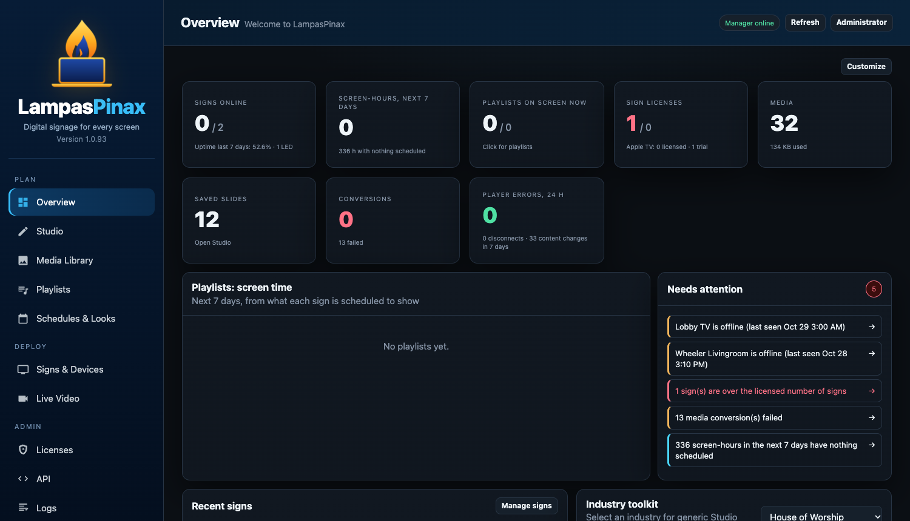
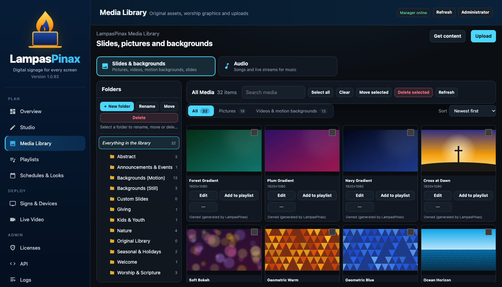
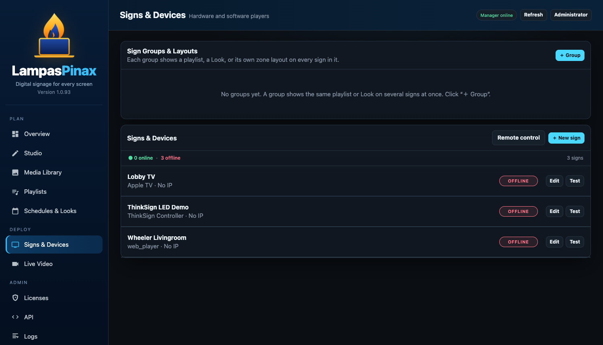
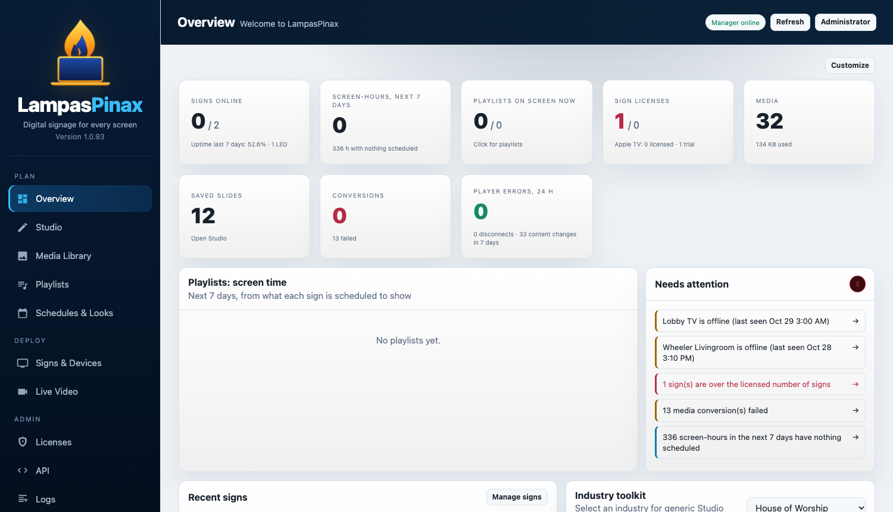

# LampasPinax

<p align="center">
  
</p>

<h1 align="center">LampasPinax</h1>
<p align="center"><b>Self-hosted digital signage for every screen.</b><br>
Design slides, schedule them, and push them to Apple TVs, BrightSign players, Windows and Mac computers, Raspberry Pis, browsers and LED controllers. From one web console that you run yourself.</p>

---

## Screenshots

<p align="center">
  <br>
  <sub><b>Overview.</b> Live sign status, check-in charts and reports, and a "Needs attention" list. Use <b>Customize</b> to choose what appears.</sub>
</p>

<p align="center">
  <br>
  <sub><b>Media Library.</b> Folders, previews, upload, motion backgrounds and starter graphics.</sub>
</p>

<p align="center">
  <br>
  <sub><b>Signs &amp; Devices.</b> Online status for every player, sign groups, and bulk <b>Remote control</b>.</sub>
</p>

<details>
<summary>Light theme</summary>
<p align="center"></p>
</details>

## Highlights

| | |
|---|---|
| **Studio** | Layered slide editor with on-canvas text editing, drag/resize, motion effects, zones and quadrant layouts. |
| **Media Library** | Folders, previews, Add to Studio, audio and live streams, plus House of Worship starter graphics. |
| **Playlists and Schedules** | Zone-tagged playlists, scheduled Looks, and screen-time reports so you can see gaps before your audience does. |
| **Live Video** | RTSP/RTSPS, ONVIF discovery and NDI sources shown in any zone. |
| **Remote control** | Reload, identify, screenshot, screen on/off schedules, volume, and urgent on-screen messages, one sign or many at once. |
| **Security** | Local, LDAP/Active Directory and OIDC sign-in, per-device tokens, optional mTLS, and signed in-place updates. |
| **AI assistant** | Describe a slide in chat; LampasPinax builds it using a constrained set of safe actions. |

## Supported players

| Player | Notes |
|---|---|
| Apple TV (tvOS 26+) | One-time pairing code; keeps playing cached content offline. |
| BrightSign | Display power, screenshots and full remote control. |
| Windows and macOS | Native full-screen players, built as installers. |
| Linux and Raspberry Pi | Generated by the server at download time. |
| Any browser | Open the player URL on a smart TV or kiosk. |
| ThinkSign LED controllers | Published to natively over TCP 10001. |


Current public release: **1.0.90** (released 2026-10-28).

Download the player installers and packages from the [Releases](../../releases) page.

Server image:

```
docker pull ghcr.io/jawheelr/lampaspinax-server:1.0.90
```


This repository is a read-only distribution mirror: it contains release information (`VERSION`, `RELEASE.json`) and
release downloads only, not source code. Contributions and forks are not accepted; see [LICENSE](LICENSE).
